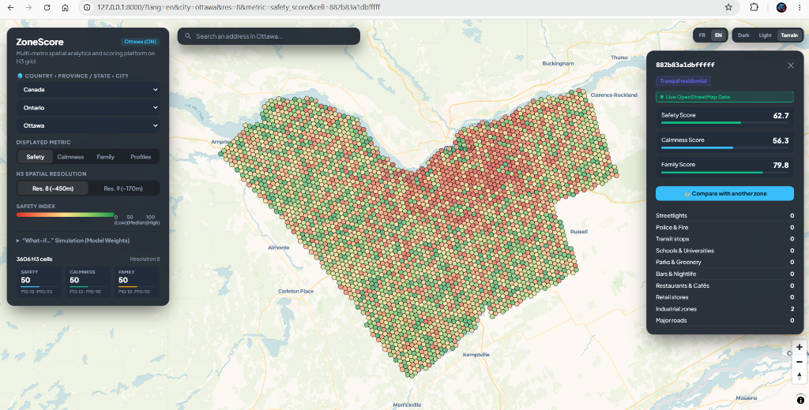

# ZoneScore — GeoSafe Cross-Border Urban Analytics Platform



> [!IMPORTANT]
> **Avertissement / Disclaimer (Educational & Research Purpose Only)**
> 
> **FR** : Ce projet est un prototype développé à visée d'étude, d'apprentissage et de recherche personnelle uniquement. Les données et indicateurs affichés (Sécurité, Quiétude, Convivialité familiale) sont des approximations statistiques basées sur des proxys d'équipements urbains OpenStreetMap ou des modèles synthétiques. Ils ne constituent en aucun cas des données officielles, ne reflètent pas des statistiques criminelles certifiées et **ne sont pas garantis réels à 100%**.
> 
> **EN**: *This project is a research prototype developed strictly for educational, learning, and demonstration purposes. All computed indices (Safety, Calmness, Family-friendliness) are statistical proxies derived from OpenStreetMap points of interest or synthetic models. They do not represent official public-safety or crime records and **are not guaranteed to be 100% accurate or exhaustive**.*

Spatial data-science platform scoring **Safety** (perceived-safety proxies), **Calmness** (tranquility vs. urban vibrancy), and **Family-Friendliness** (schools, parks, quiet streets) across major North American metropolitan areas on an **Uber H3** hexagonal grid (resolutions 8 & 9). Bare-metal stack — no Docker, no standalone database. Québec is one of the supported cities alongside major Canadian and US metropolitan areas.

Supported Metros — pick **Pays › Province / État › Ville** in the UI:
- **Canada**: 
  - **Québec**: Québec (QC), Montréal (QC), Gatineau (QC)
  - **Ontario**: Ottawa (ON), Toronto (ON)
  - **British Columbia**: Vancouver (BC)
  - **Alberta**: Calgary (AB), Edmonton (AB)
- **United States**: 
  - **New York**: New York (NY)
  - **California**: Los Angeles (CA)
  - **Illinois**: Chicago (IL)
  - **Washington**: Seattle (WA)
  - **Massachusetts**: Boston (MA)
  - **Texas**: Houston (TX)

## Architecture & Real Data Strategy

ZoneScore offers a dual real-data architecture:
1. **Local Geofabrik PBF Extraction (DuckDB Spatial)**: Fast, offline extraction of entire metropolitan regions (e.g. `data/raw/quebec-latest.osm.pbf`) via DuckDB's spatial engine (`ST_ReadOSM`) without Overpass timeout risks.
2. **On-Demand Live OSM Enrichment**: Clicking on any H3 hexagon queries the live OpenStreetMap REST API (`api.openstreetmap.org`) in real-time (< 1s) to show verified amenities, recent points of interest, and active streetlamps with an in-memory session cache.
3. **Deterministic Synthetic Fallback**: Fallback generator with downtown-distance exponential gradients when offline (`URBIS_OFFLINE=1`).

## Stack

| Layer | Technology |
|---|---|
| Spatial indexing | H3 v4 (`h3-py`) |
| Data engine | Python 3.11, pandas, shapely, geopandas, osmnx, DuckDB Spatial (embedded), Parquet |
| ML / analytics | scikit-learn — RobustScaler + K-Means zone profiling |
| Backend API | FastAPI (async, Pydantic v2, GZip, CORS, Multi-City hierarchical routing) |
| Frontend | MapLibre GL SPA (Country/Province/City cascading selects, Address Search, Zone Comparator, Live OSM Badging, Basemaps) |

## Quick start

```bash
./run.sh                 # venv + deps + ETL (auto) + server on :8000
./run.sh --offline       # force deterministic synthetic data (no network)
make install test run    # equivalent Make workflow
```

Windows (PowerShell) equivalent:

```powershell
python -m venv .venv
.venv\Scripts\python -m pip install -r backend\requirements.txt
cd backend
..\.venv\Scripts\python -m pytest
..\.venv\Scripts\python -m uvicorn app.main:app --port 8000
```

## Deployment on Hugging Face Spaces (100% Free Cloud Hosting)

ZoneScore is pre-configured for 1-click deployment on **Hugging Face Spaces** using the **Gradio SDK** (100% Free, no credit card needed):

1. Rendez-vous sur [Hugging Face Spaces](https://huggingface.co/spaces) et cliquez sur **Create new Space**.
2. Nommez votre Space (ex: `ZoneScore`), choisissez une licence (ex: `mit`).
3. Sélectionnez le SDK : **Gradio** (l'option gratuite avec l'icône orange).
4. Reliez votre dépôt GitHub (`arhadnane/ZoneScore`) ou poussez ce dépôt sur le remote Hugging Face.
5. Hugging Face va installer automatiquement `requirements.txt`, exécuter `space_app.py` et déployer votre plateforme en HTTPS gratuit !

Open **http://127.0.0.1:8000** (ou votre URL Hugging Face Spaces) :
- **Cascading Selectors** : Select Country (Canada, USA) › Province/State › City.
- **Metrics** : Sécurité, Quiétude, Familial, Profils K-Means.
- **Tooltip Hover** : Instant 60fps local inspection of scores and clusters.
- **Live Inspection** : Click any hex to load real-time OpenStreetMap venues, recent POIs, and live indicators.
- **Search** : Canadian and US address autocompletion with automatic metro detection.
- **Comparator** : Click *Comparer cette zone* to compare two urban areas side-by-side.
- **Themes** : Switch between Dark, Light, and Voyager basemaps.
- **Simulation** : Re-weight model parameters in real-time.

## Data flow

1. **Boundary** — Accurate city core bounding boxes (`app/core/cities.py`).
2. **Grid** — H3 cells at resolutions 8 and 9 covering the boundary.
3. **Features** — 10 urban feature categories counted per cell:
   - Priority 1: Local Geofabrik PBF extracts via DuckDB Spatial (`ST_ReadOSM`).
   - Priority 2: Remote OSM API / `osmnx` extraction with boundary polygon expansion.
   - Priority 3: Deterministic synthetic generator with downtown-distance gradient.
4. **Scores** — RobustScaler → weighted blend → percentile rank (0–100) for Safety, Calmness, and Family indices.
5. **Profiles** — K-Means (k=5) with human-readable cluster labels.
6. **Storage** — Parquet per resolution and city in `data/processed/` + DuckDB views (`zones_{city}_res{res}`) in `data/processed/zonescore.duckdb`.

## API Endpoints

| Endpoint | Description |
|---|---|
| `GET /api/cities` | List supported metropolitan cities with country and province hierarchy |
| `GET /api/health` | Service status, loaded cities, and zone counts |
| `GET /api/zones?city={city}&resolution=8` | GeoJSON FeatureCollection with pre-computed scores and profiles |
| `GET /api/zones/{h3}?live=true` | Full detail, breakdown counts, centroid, cluster, and live OSM POIs |
| `GET /api/locate?lat={lat}&lng={lng}` | Find the H3 cell at coordinates or closest match |
| `GET /api/stats?city={city}&resolution=8` | Distribution statistics & profile histogram |
| `GET /api/weights` | Default model weights (Safety, Calmness, Family) |
| `POST /api/simulate` | Re-score with user weight overrides (what-if analysis) |

Interactive Swagger documentation: `http://127.0.0.1:8000/docs`.

## Configuration (env, prefix `URBIS_`)

`URBIS_OFFLINE=1` (synthetic data), `URBIS_DATA_DIR`, `URBIS_RESOLUTIONS='[8,9]'`, `URBIS_PORT`, `URBIS_CITY_QUERY`.

## Tests

```bash
cd backend && ..\.venv\Scripts\python -m pytest    # or make test
```

Fully offline & deterministic — pipeline, scoring, clustering, and end-to-end API suites.

## Ad-hoc analytics (DuckDB)

```sql
-- .venv python: import duckdb; duckdb.connect('data/processed/zonescore.duckdb')
SELECT profile, count(*), avg(safety_score) FROM zones_montreal_res8 GROUP BY profile;
```

See [DECISIONS.md](DECISIONS.md) for the architectural decision log.
